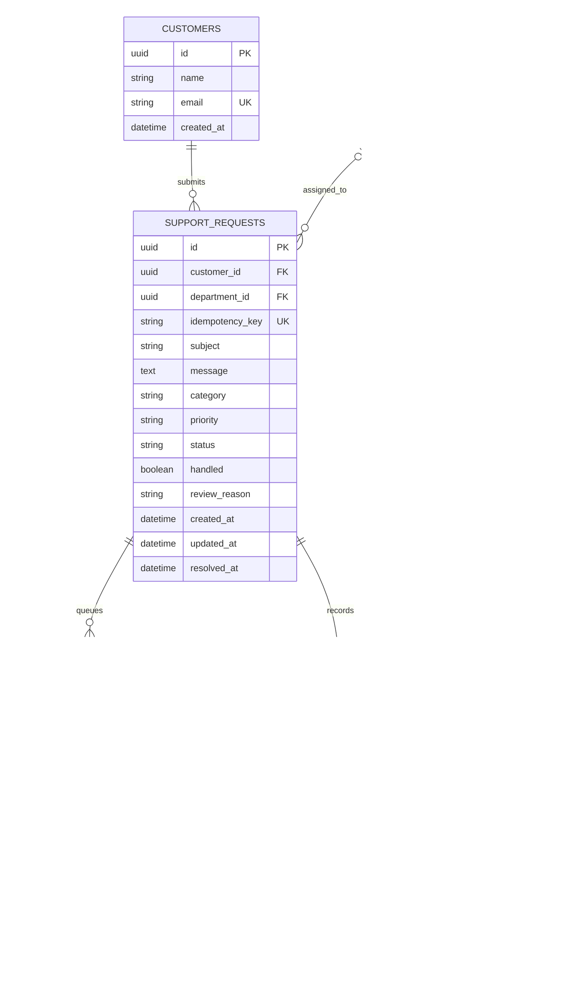

# Customer Support Request Application

A small FastAPI + PostgreSQL support-intake foundation with deterministic triage and an n8n email/Slack notification workflow.

## Architecture

- FastAPI validates and stores requests before any notification is attempted.
- PostgreSQL is the source of truth for customers, support requests, departments, routes, audit events, and notification work.
- SQLAlchemy models live as one class per module in `app/model/` (customer, department, routing rule, support request, notification, audit event, and request status).
- A deterministic policy assigns only supported categories. Ambiguous or unclassified requests enter `needs_review`.
- n8n polls and claims notification outbox rows, delivers them, and records retry/failure state.
- An LLM is not part of this first runnable slice. If added, its structured classification should be validated and treated as a suggestion; the policy and database routing remain authoritative.

## Entity relationship diagram



## Run locally

Use Python 3.11 or newer.

1. Create and activate a virtual environment, then install dependencies:

   ```sh
   python3 -m venv .venv
   source .venv/bin/activate
   pip install -r requirements.txt
   ```

2. Copy `.env.example` to `.env`. Replace the admin and n8n keys with different random values. Set one or both destinations for every department you want to activate. Email destinations are email addresses; Slack destinations must be Slack channel IDs such as `C0123456789`.

3. Start PostgreSQL and n8n:

   ```sh
   docker compose up -d postgres n8n
   ```

   The example PostgreSQL password is for local development only. Do not use it in a deployed environment.

4. Initialize tables and routing, then start the API:

   ```sh
   python -m app.init_db
   python -m app.seed
   uvicorn app.main:app --reload
   ```

   `app.init_db` uses SQLAlchemy `create_all` for local bootstrap, not production schema migration. Use a migration tool such as Alembic before deploying schema changes.

5. Import [support-notifications.json](./n8n/support-notifications.json) into n8n at `http://localhost:5678`. Create PostgreSQL, Slack, and SMTP credentials in n8n. For PostgreSQL use host `postgres`, port `5432`, database `support`, username `support`, and the configured local password. Set a valid sender address in both email nodes, set the operations alert recipient, and activate the workflow.

   The workflow uses `$1` query replacements for database updates. Keep the workflow's query parameters enabled; do not concatenate untrusted values into SQL.

## Submit a request

```sh
curl -i http://localhost:8000/requests \
  -H 'Content-Type: application/json' \
  -H 'Idempotency-Key: website-form-submit-123' \
  -d '{
    "contact_name": "Casey Customer",
    "contact_email": "casey@example.com",
    "subject": "Invoice charged twice",
    "message": "I was charged twice for the invoice for this month."
  }'
```

The idempotency key must be stable across retries of the same submission. Reusing it returns the existing request with HTTP 200; a new key creates a new request. New requests return a UUID reference, category, priority, status, and department when safely routed.

Known categories are `billing`, `account`, `technical`, and `security`. The seed script maps these categories to departments. Ambiguous or unknown requests, and requests without an active category route, are persisted as `needs_review` and sent to the configured Support Triage destination when available. Otherwise they remain in the database for an operator to find. An acknowledgement is queued for the customer.

The deterministic policy marks `security incident`, `account compromised`, `unauthorized access`, `data breach`, `service outage`, `system-wide outage`, or `all users are affected` as urgent. Keyword overlap across non-security categories or no recognized category requires human review. These sample rules must be replaced or approved by the actual support organization before production.

The current department email/Slack notification includes the request subject and message so staff can act on it without a separate support portal. Configure only restricted department destinations; do not ask customers to send passwords or API secrets. Add content redaction and verified, access-controlled request viewing before production.

## Request lifecycle and support updates

`handled` is persisted and constrained in PostgreSQL to match the lifecycle: it is false until status is `resolved` or `closed`, and true for those statuses. A valid status update also creates an audit event and a customer email notification.

Status updates require the configured support API key:

```sh
curl -X PATCH "http://localhost:8000/requests/REQUEST_UUID/status" \
  -H "Authorization: Bearer $SUPPORT_ADMIN_API_KEY" \
  -H 'Content-Type: application/json' \
  -d '{"status":"resolved"}'
```

Requests in `needs_review` can be assigned by a support operator to an active department with a configured destination:

```sh
curl -X POST "http://localhost:8000/requests/REQUEST_UUID/assignment" \
  -H "Authorization: Bearer $SUPPORT_ADMIN_API_KEY" \
  -H 'Content-Type: application/json' \
  -d '{"department_id":"DEPARTMENT_UUID"}'
```

Allowed transitions are enforced by the API. Status and assignment operations are intentionally protected by a shared development key in this starter; replace this with real staff authentication, role-based access control, and identity-aware auditing before production. Public customer status lookup and verified account linking are not implemented.

## Notification reliability

The n8n workflow atomically claims up to 25 pending notifications with `FOR UPDATE SKIP LOCKED`, reducing duplicate concurrent delivery. A failed send is retried after five minutes, up to five attempts. A worker lease is used to recover work left in `processing` if an execution stops unexpectedly. Exhausted notifications are marked `failed`; the workflow also polls that state and emails an operations recipient. Configure the sender and operations recipient in the workflow before activation.

n8n cannot guarantee exactly-once delivery if a provider accepts a message but the workflow crashes before marking it sent. The outbox prevents lost work, and the reference ID makes duplicate notices recognizable. Monitor n8n execution failures and database availability externally too; the workflow cannot alert on its own complete outage.

## Validation and tests

```sh
pytest
```

Tests use an isolated in-memory SQLite database. PostgreSQL remains the target runtime; n8n's outbox SQL is PostgreSQL-specific.

## Learn the n8n workflow

Open the imported workflow and follow it from each trigger:

- **Every minute** is a Schedule Trigger. It starts the notification-delivery branch on a timer.
- **Claim pending notifications** is a PostgreSQL node. Its SQL claims a small batch, so two workflow executions should not send the same queued row simultaneously.
- **Route by channel** is a Switch node. It sends each item to the Slack node or email node based on the channel value in the outbox row.
- **Send Slack message / Send email** are action nodes. Successful delivery reaches **Mark sent**; transient failure reaches **Record delivery failure**, which schedules another attempt. Department messages contain request content, so destinations need suitable access restrictions.
- **Check failed notifications** starts a second timer branch. It finds notifications that exhausted their retries and sends a limited operational alert.

An n8n execution is an observable run of these nodes. Inspect its input/output and errors while learning; do not add customer message bodies to execution logs or alert emails. Credentials are configured in n8n and are separate from the workflow JSON and department routing rows.

## Before production

- Add staff authentication/authorization and verified customer identity before exposing request reads or status changes.
- Add abuse controls such as request rate limits, CAPTCHA or equivalent, and email verification before enabling public guest acknowledgements.
- Add Alembic migrations, backups, TLS, least-privilege database users, secret rotation, and environment-specific deployment configuration.
- Define organization-approved priority, escalation, customer-notice, privacy, and retention policies.
- Add an LLM provider only behind structured-output validation, timeouts, and human-review fallback; never use its free-form output to bypass routing policy.
- Add external monitoring/alerting for API, PostgreSQL, and n8n availability; restrict logs and notifications to non-sensitive metadata.
